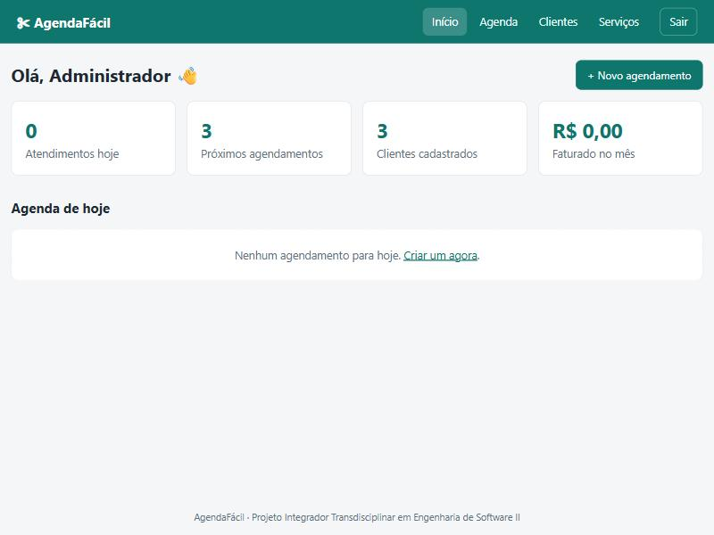

# ✂ AgendaFácil

**Sistema web de agendamento para barbearias e salões de beleza.**
Projeto Integrador Transdisciplinar em Engenharia de Software II — Cruzeiro do Sul Virtual.



## O problema
Pequenos salões controlam horários no papel ou no WhatsApp. O resultado é cliente marcado no mesmo horário, esquecimentos e nenhum controle de faturamento.

## A solução
- 🔐 Login com senha criptografada
- 👥 Cadastro e busca de clientes
- 💈 Catálogo de serviços com preço e duração (ativar/desativar)
- 📅 Agendamentos com **bloqueio automático de conflito de horário**
- ✅ Concluir, cancelar e reabrir atendimentos
- 📊 Painel com agenda do dia e faturamento do mês
- 📱 Funciona no computador e no celular

## Tecnologias
| Camada | Tecnologia |
|--------|-----------|
| Back-end | Python 3 + Flask (padrão **MVC**) |
| Front-end | HTML5, CSS3 e JavaScript |
| Banco de dados | SQLite 3 |
| Testes | pytest (48 testes) |
| Hospedagem | Render |

## Como rodar no seu computador
```bash
pip install -r requirements.txt
python run.py
```
Acesse http://127.0.0.1:5000 com o usuário de demonstração:
**admin@agendafacil.com** / **agenda123**

## Como rodar os testes
```bash
python -m pytest -v
```

## Links
- 📁 **Repositório:** https://github.com/lucasaugb/agendafacil-pit2
- 🌐 **Sistema online:** https://agendafacil-pit2.onrender.com  _(plano grátis: se ficar parado, a 1ª abertura pode levar ~50s)_
- 🎥 **Vídeo de apresentação:** _(adicionar)_

## Documentação
| Situação | Conteúdo |
|----------|----------|
| **1. Planejamento revisado** | [Escopo e requisitos](docs/situacao-1/01-escopo-e-requisitos.md) · [Modelagem UML](docs/situacao-1/02-modelagem-uml.md) · [Banco de dados e dicionário](docs/situacao-1/03-banco-de-dados.md) · [IHC e telas](docs/situacao-1/04-ihc-telas.md) |
| **2. Desenvolvimento** | [Arquitetura MVC](docs/situacao-2/arquitetura-mvc.md) · [Manual de uso](docs/situacao-2/manual-de-uso.md) · [Código-fonte](app/) · [Script do banco](database/schema.sql) |
| **3. Testes e validação** | [Plano e resultado de testes](docs/situacao-3/01-plano-e-resultado-de-testes.md) · [Formulário de teste](docs/situacao-3/02-formulario-teste-usuario.md) · [Laudo de qualidade](docs/situacao-3/03-laudo-de-qualidade.md) |

## Estrutura do projeto
```
app/
 ├── models/        → M: regras de negócio e acesso ao banco
 ├── views/         → V: telas HTML (Jinja2)
 ├── controllers/   → C: rotas
 └── static/        → CSS e JavaScript
database/schema.sql → projeto físico do banco
tests/              → testes automatizados
docs/               → documentação das 3 situações
```
