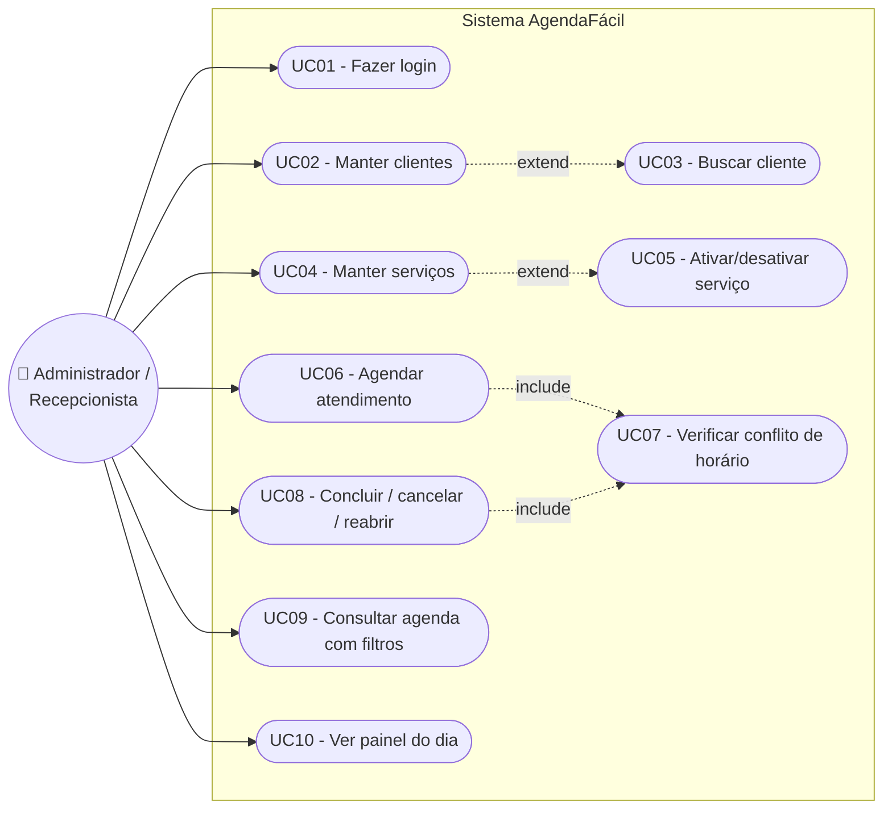
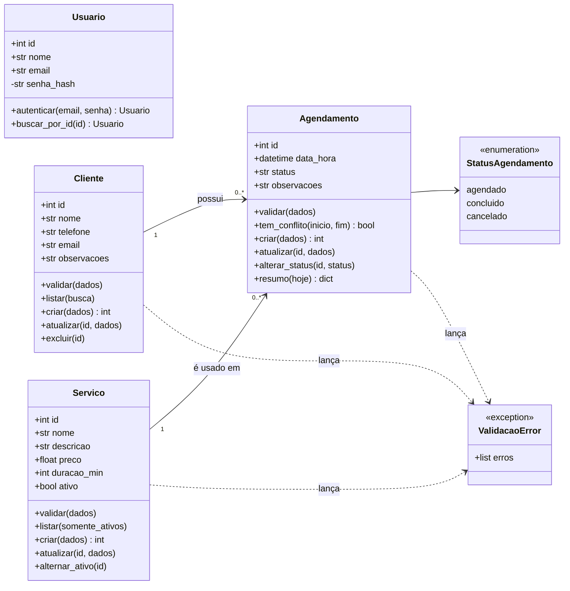
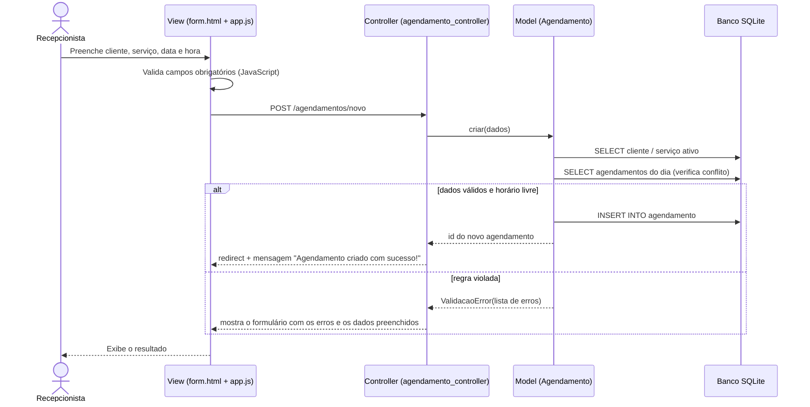
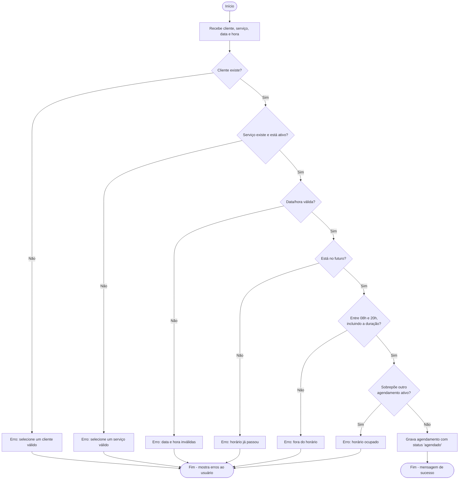
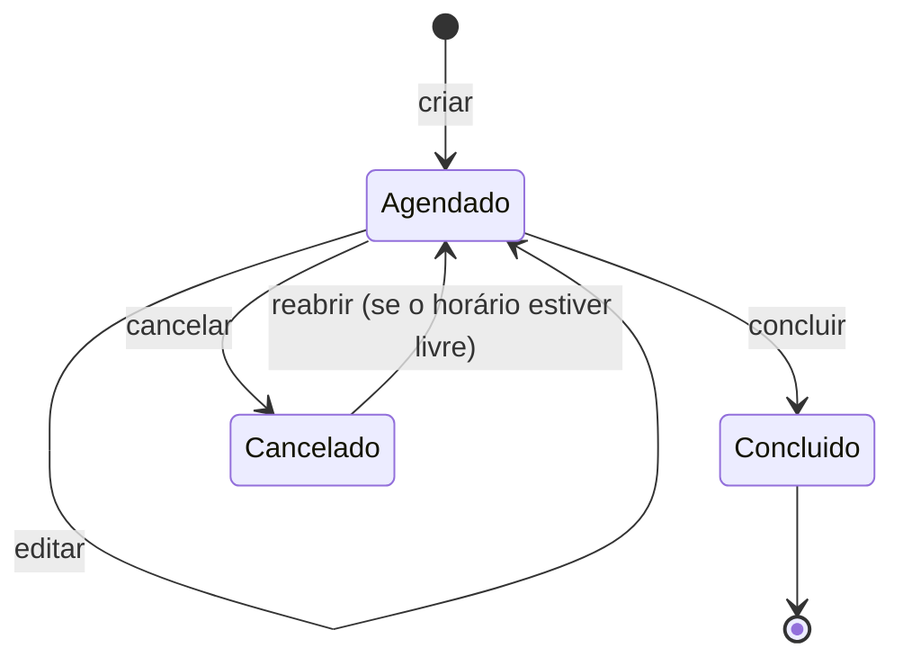

# 2. Modelagem UML — AgendaFácil

> Os diagramas estão em **Mermaid**, que o GitHub desenha automaticamente ao abrir este arquivo.

## 2.1 Diagrama de Casos de Uso

### Descrição do caso de uso principal — UC06 Agendar atendimento

| Item | Descrição |
|------|-----------|
| Ator | Administrador / Recepcionista |
| Pré-condição | Estar logado; existir ao menos um cliente e um serviço ativo |
| Fluxo principal | 1. Clica em "Novo agendamento" · 2. Escolhe cliente e serviço · 3. Informa data e hora · 4. Clica em "Salvar" · 5. O sistema valida (UC07) · 6. Grava e mostra "Agendamento criado com sucesso!" |
| Fluxo alternativo A1 | Campo vazio → o navegador destaca o campo e mostra "Este campo é obrigatório." |
| Fluxo alternativo A2 | Data no passado → "Não é possível agendar em uma data/hora que já passou." |
| Fluxo alternativo A3 | Fora do expediente → "Fora do horário de funcionamento (08h às 20h)." |
| Fluxo alternativo A4 | Horário ocupado → "Já existe um agendamento nesse horário. Escolha outro horário." |
| Pós-condição | Agendamento salvo com status **agendado** |

## 2.2 Diagrama de Classes (modelo de domínio / persistência)

## 2.3 Diagrama de Sequência — Criar agendamento (padrão MVC)

## 2.4 Diagrama de Atividades — Validação do agendamento

## 2.5 Diagrama de Estados — Agendamento

## 2.6 Revisões feitas na modelagem (Kaizen)

| # | O que mudou | Por quê |
|---|-------------|---------|
| 1 | Criado o atributo `duracao_min` em Serviço | Sem a duração não dá para detectar conflito real (ex.: 10:00 de 50 min bate com 10:30) |
| 2 | Serviço ganhou `ativo` em vez de ser excluído | Excluir apagaria o histórico de agendamentos antigos |
| 3 | Status virou enumeração fechada | Evita valores inválidos e permite a restrição `CHECK` no banco |
| 4 | Criada a classe `ValidacaoError` | Padroniza as mensagens de erro mostradas ao usuário |
| 5 | Incluído o estado "reabrir" | Feedback: o cliente às vezes desiste do cancelamento |
