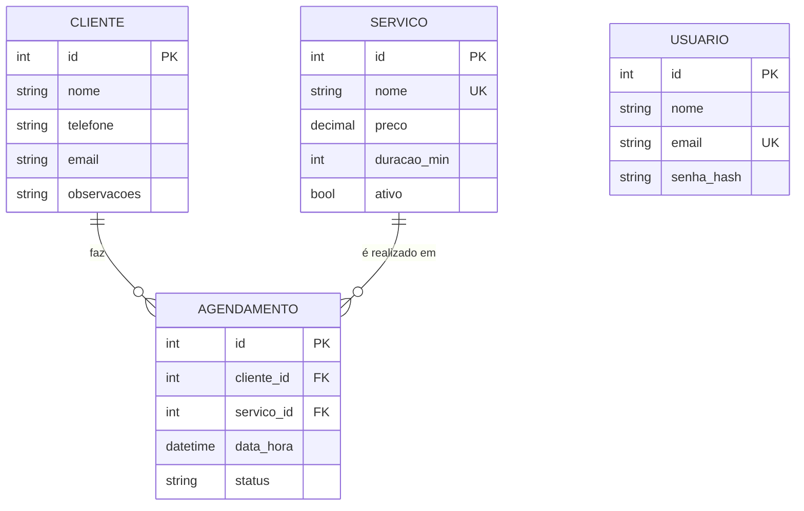

# 3. Projeto de Banco de Dados — AgendaFácil

**SGBD escolhido:** SQLite 3, o banco de dados mais usado do mundo. Vem embutido no Python, não precisa de servidor e é fácil de manter. Se o projeto crescer, o mesmo SQL migra facilmente para PostgreSQL ou MySQL.

## 3.1 Projeto Conceitual (DER)



**Cardinalidades:**
- Um **cliente** pode ter **zero ou muitos** agendamentos; cada agendamento pertence a **exatamente um** cliente (1:N).
- Um **serviço** pode estar em **zero ou muitos** agendamentos; cada agendamento tem **exatamente um** serviço (1:N).
- **Usuário** é independente: representa quem opera o sistema.

## 3.2 Projeto Lógico (modelo relacional normalizado)

```
USUARIO     (id, nome, email, senha_hash, criado_em)
CLIENTE     (id, nome, telefone, email, observacoes, criado_em)
SERVICO     (id, nome, descricao, preco, duracao_min, ativo)
AGENDAMENTO (id, cliente_id → CLIENTE.id, servico_id → SERVICO.id,
             data_hora, status, observacoes, criado_em)
```

### Verificação da normalização

| Forma normal | Como foi atendida |
|--------------|-------------------|
| **1FN** | Todos os atributos são atômicos (sem listas nem campos repetidos). O telefone é um único valor e não há "servico1, servico2" no agendamento. |
| **2FN** | Todas as chaves primárias são simples (`id`), então não existe dependência parcial. |
| **3FN** | Não há dependência transitiva. O **preço** e a **duração** ficam só em SERVICO, nunca copiados no agendamento, e o nome do cliente fica só em CLIENTE. O agendamento guarda apenas as chaves estrangeiras. |

> **Decisão consciente:** como o preço não é copiado no agendamento, se o preço de um serviço mudar, os relatórios antigos mostram o preço novo. Para a versão 1.0 isso foi aceito. Numa versão futura, um campo `preco_cobrado` em AGENDAMENTO resolve o problema (desnormalização controlada).

## 3.3 Projeto Físico

O script completo está em [`database/schema.sql`](../../database/schema.sql). Principais pontos:

- `PRAGMA foreign_keys = ON` liga a integridade referencial no SQLite;
- `ON DELETE RESTRICT` impede apagar um cliente ou serviço que tem agendamentos;
- `CHECK` garante o domínio dos atributos (preço ≥ 0, duração entre 5 e 480 e status dentro da lista);
- `UNIQUE` em `usuario.email` e `servico.nome`;
- **Índices** em `agendamento.data_hora`, `agendamento.cliente_id` e `cliente.nome` deixam rápidas a agenda do dia e a busca.

## 3.4 Dicionário de Dados

### Tabela `usuario` — pessoas que acessam o sistema

| Campo | Tipo | Nulo? | Chave | Domínio / Regra | Descrição |
|-------|------|-------|-------|-----------------|-----------|
| id | INTEGER | Não | PK | Autoincremento | Identificador do usuário |
| nome | VARCHAR(100) | Não | | Texto livre | Nome exibido no sistema |
| email | VARCHAR(120) | Não | UNIQUE | E-mail válido, minúsculo | Login do usuário |
| senha_hash | VARCHAR(255) | Não | | Hash PBKDF2/scrypt (Werkzeug) | Senha criptografada |
| criado_em | TEXT | Não | | Data/hora ISO, padrão = agora | Data de cadastro |

### Tabela `cliente` — clientes do estabelecimento

| Campo | Tipo | Nulo? | Chave | Domínio / Regra | Descrição |
|-------|------|-------|-------|-----------------|-----------|
| id | INTEGER | Não | PK | Autoincremento | Identificador do cliente |
| nome | VARCHAR(100) | Não | | Mínimo 3 caracteres | Nome completo |
| telefone | VARCHAR(20) | Não | | 10 ou 11 dígitos (DDD + número) | Contato principal |
| email | VARCHAR(120) | Sim | | Formato de e-mail | Contato opcional |
| observacoes | TEXT | Sim | | Texto livre | Preferências, alergias etc. |
| criado_em | TEXT | Não | | Data/hora ISO | Data de cadastro |

### Tabela `servico` — serviços oferecidos

| Campo | Tipo | Nulo? | Chave | Domínio / Regra | Descrição |
|-------|------|-------|-------|-----------------|-----------|
| id | INTEGER | Não | PK | Autoincremento | Identificador do serviço |
| nome | VARCHAR(80) | Não | UNIQUE | Mínimo 2 caracteres | Nome do serviço |
| descricao | TEXT | Sim | | Texto livre | Detalhes |
| preco | DECIMAL(8,2) | Não | | ≥ 0 | Valor em reais |
| duracao_min | INTEGER | Não | | 5 a 480 | Duração em minutos |
| ativo | INTEGER | Não | | 0 = inativo, 1 = ativo | Se pode ser agendado |

### Tabela `agendamento` — atendimentos marcados

| Campo | Tipo | Nulo? | Chave | Domínio / Regra | Descrição |
|-------|------|-------|-------|-----------------|-----------|
| id | INTEGER | Não | PK | Autoincremento | Identificador |
| cliente_id | INTEGER | Não | FK → cliente.id | Cliente existente | Quem será atendido |
| servico_id | INTEGER | Não | FK → servico.id | Serviço ativo | O que será feito |
| data_hora | TEXT | Não | | `AAAA-MM-DD HH:MM`, futuro, 08h–20h | Início do atendimento |
| status | VARCHAR(12) | Não | | agendado, concluido, cancelado | Situação atual |
| observacoes | TEXT | Sim | | Texto livre | Anotações |
| criado_em | TEXT | Não | | Data/hora ISO | Quando foi marcado |

## 3.5 Consultas importantes

```sql
-- Agenda do dia
SELECT a.data_hora, c.nome, s.nome, s.preco
  FROM agendamento a
  JOIN cliente c ON c.id = a.cliente_id
  JOIN servico s ON s.id = a.servico_id
 WHERE date(a.data_hora) = date('now', 'localtime')
 ORDER BY a.data_hora;

-- Faturamento do mês (somente concluídos)
SELECT SUM(s.preco)
  FROM agendamento a JOIN servico s ON s.id = a.servico_id
 WHERE a.status = 'concluido'
   AND strftime('%Y-%m', a.data_hora) = strftime('%Y-%m', 'now', 'localtime');
```
