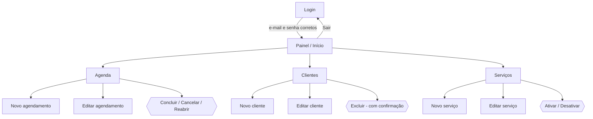
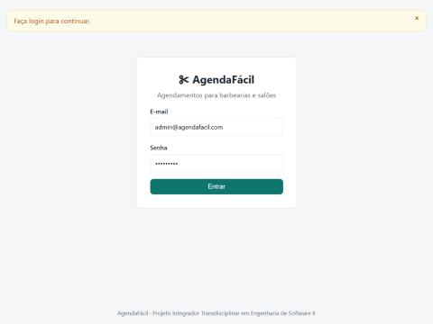
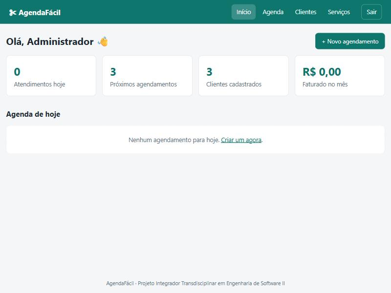
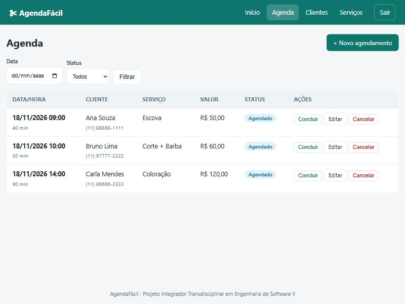
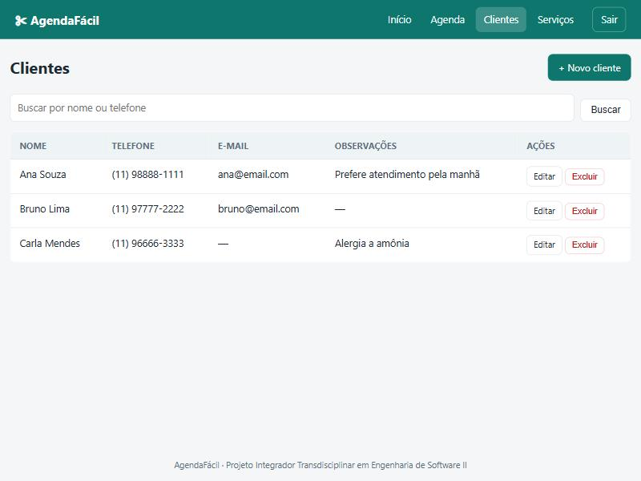
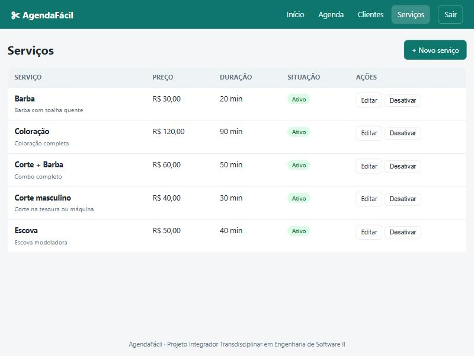
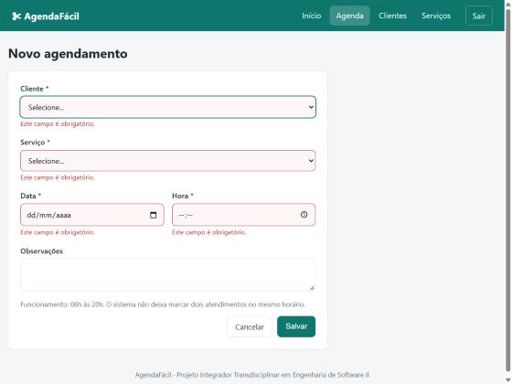
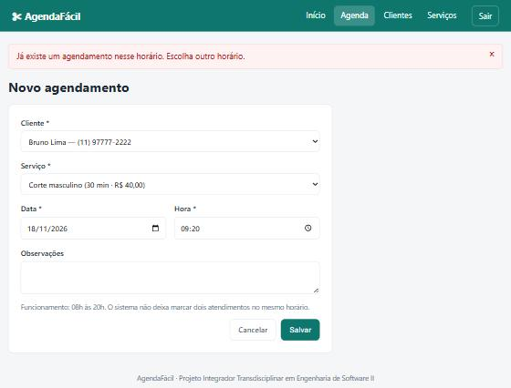
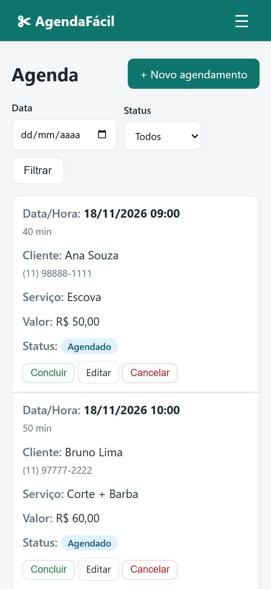

# 4. IHC — Interface Humano-Computador

## 4.1 Mapa de navegação (arquitetura da informação)

O menu superior fica fixo em todas as telas, com no máximo 1 clique até qualquer área. No celular ele vira um botão ☰.

## 4.2 Telas

| Tela | Elementos | Objetivo |
|------|-----------|----------|
| Login | Campos de e-mail e senha, botão Entrar | Acesso seguro |
| Painel | 4 cards (hoje, próximos, clientes, faturamento) + tabela da agenda de hoje | Visão rápida do dia |
| Agenda | Filtro por data e status, tabela com ações | Gerenciar atendimentos |
| Form. de agendamento | Listas de cliente e serviço, calendário, relógio | Marcar horário |
| Clientes | Campo de busca, tabela, Editar/Excluir | Gerenciar clientes |
| Form. de cliente | Nome, telefone (com máscara), e-mail, observações | Cadastro |
| Serviços | Tabela com preço, duração e situação | Catálogo |
| Erro 404/500 | Mensagem amigável e botão "Voltar ao início" | Recuperação de erro |

### Capturas de tela

| Login | Painel |
|---|---|
|  |  |
| **Agenda** | **Clientes** |
|  |  |
| **Serviços** | **Validação de campos** |
|  |  |
| **Conflito de horário bloqueado** | **Versão celular** |
|  |  |

## 4.3 Mensagens do sistema

| Situação | Tipo | Mensagem |
|----------|------|----------|
| Login inválido | Erro | E-mail ou senha incorretos. |
| Acesso sem login | Aviso | Faça login para continuar. |
| Campo obrigatório vazio | Erro (no campo) | Este campo é obrigatório. |
| Nome curto | Erro | O nome precisa ter pelo menos 3 letras. |
| Telefone inválido | Erro | Telefone inválido. Use DDD + número, ex.: (11) 98888-1111. |
| E-mail inválido | Erro | E-mail inválido. |
| Preço negativo | Erro | O preço não pode ser negativo. |
| Duração fora da faixa | Erro | A duração deve ficar entre 5 e 480 minutos. |
| Serviço repetido | Erro | Já existe um serviço com esse nome. |
| Horário no passado | Erro | Não é possível agendar em uma data/hora que já passou. |
| Fora do expediente | Erro | Fora do horário de funcionamento (08h às 20h). |
| Conflito | Erro | Já existe um agendamento nesse horário. Escolha outro horário. |
| Excluir cliente com histórico | Erro | Este cliente possui agendamentos e não pode ser excluído. |
| Cadastro OK | Sucesso | Cliente / Serviço / Agendamento cadastrado com sucesso! |
| Exclusão / cancelamento | Confirmação | "Excluir o cliente X? Esta ação não pode ser desfeita." |

## 4.4 Princípios de IHC aplicados (material teórico)

| Princípio | Como foi aplicado no AgendaFácil |
|-----------|----------------------------------|
| **Clara** | Rótulos simples ("Novo cliente", "Salvar"), campos obrigatórios marcados com * |
| **Consistente** | Todas as listas seguem o mesmo padrão: título, botão "+ Novo" à direita, tabela e ações |
| **Simples** | Só 4 itens no menu, sem telas desnecessárias |
| **Controlada pelo usuário** | Nada acontece sozinho, e o usuário sempre tem o botão "Cancelar" |
| **Direta** | Ao concluir ou cancelar, o selo de status muda na mesma hora na tabela |
| **Empática e reversível** | Confirmação antes de excluir, agendamento cancelado pode ser reaberto e serviço é desativado em vez de apagado |
| **Dá resposta (feedback)** | Mensagens verdes (sucesso), vermelhas (erro) e amarelas (aviso), além do erro embaixo do campo |
| **Esteticamente agradável** | Paleta verde-petróleo, bastante espaço em branco e selos coloridos por status |
| **Padrões (defaults)** | Calendário não deixa escolher dia passado, horário limitado a 08h–20h e máscara automática no telefone |
| **Comunica o que acontece** | Item do menu ativo fica destacado, e listas vazias explicam o que fazer ("Criar um agora") |

## 4.5 Melhorias de interface feitas na revisão

1. Erros de validação passaram a aparecer **embaixo do próprio campo**, e não só no topo da página;
2. O formulário **mantém os dados digitados** quando dá erro, para o usuário não precisar digitar tudo de novo;
3. Incluída **máscara de telefone**;
4. Layout **responsivo**: no celular a tabela vira cartões;
5. A mensagem de erro do campo **some sozinha** quando o usuário corrige o valor.
