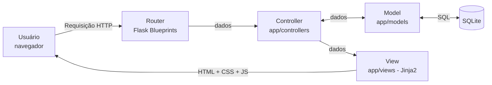

# Arquitetura — padrão MVC



| Camada | Pasta | Responsabilidade | Exemplo |
|--------|-------|------------------|---------|
| **Model** | `app/models/` | Regras de negócio, validação e acesso ao banco | `Agendamento.validar()` verifica conflito de horário |
| **View** | `app/views/` + `app/static/` | Telas HTML (Jinja2), CSS e JavaScript | `agendamentos/form.html` |
| **Controller** | `app/controllers/` | Recebe a requisição, chama o Model e escolhe a View | `agendamento_controller.novo()` |

**Por que separar assim?**
- A regra "não pode ter conflito de horário" fica **em um único lugar** (Model). A tela e o controller não precisam saber como ela funciona;
- Dá para **testar as regras sem abrir o navegador** (`tests/test_models.py`);
- Se um dia a tela virar um app de celular, o Model continua o mesmo.

## Tecnologias

| Item | Tecnologia |
|------|-----------|
| Linguagem do back-end | Python 3.13 |
| Framework web | Flask 3 |
| Banco de dados | SQLite 3 |
| Front-end | HTML5, CSS3, JavaScript puro (sem framework) |
| Templates | Jinja2 |
| Testes | pytest (48 testes: unitários e de integração) |
| Servidor de produção | Gunicorn |
| Controle de versão | Git + GitHub |

## Estrutura de pastas

```
├── app/
│   ├── __init__.py          # cria a aplicação e registra os controllers
│   ├── database.py          # conexão com o SQLite
│   ├── seed.py              # dados de exemplo
│   ├── models/              # M - regras de negócio
│   ├── controllers/         # C - rotas
│   ├── views/               # V - telas HTML
│   └── static/              # CSS e JavaScript
├── database/schema.sql      # projeto físico do banco
├── tests/                   # testes automatizados (pytest)
├── docs/                    # documentação das 3 situações
├── run.py                   # inicia o sistema
└── requirements.txt         # bibliotecas usadas
```

## Tratamento de erros

| Tipo de erro | Onde é tratado | O que o usuário vê |
|--------------|----------------|--------------------|
| Campo vazio/formato errado | JavaScript (`app.js`) | Campo em vermelho com mensagem embaixo |
| Regra de negócio violada | Model lança `ValidacaoError` e o Controller mostra | Mensagem vermelha no topo e dados preservados |
| Integridade do banco | `CHECK`, `UNIQUE`, `FOREIGN KEY` | Mensagem amigável (ex.: "Já existe um serviço com esse nome.") |
| Página inexistente | `errorhandler(404)` | Tela "Ops! Página não encontrada" |
| Erro inesperado | `errorhandler(500)` | Tela "Ocorreu um erro inesperado" |
| Acesso sem login | Decorator `login_obrigatorio` | Redireciona para o login |
